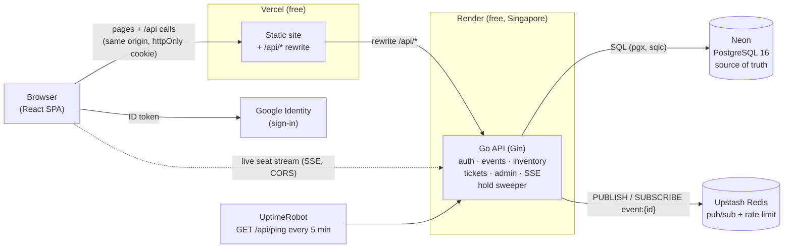
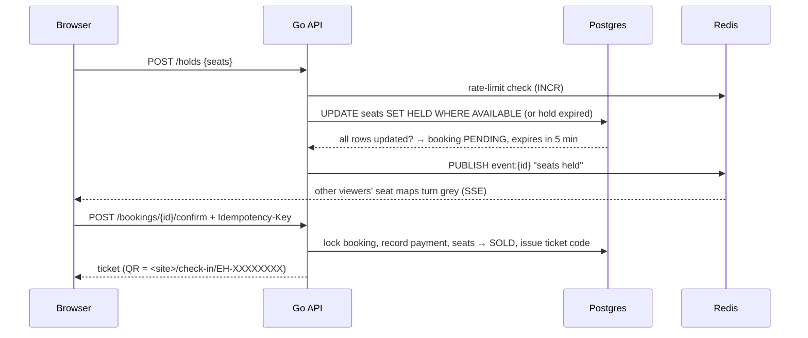

# EventHub

[](https://github.com/Badri-2915/eventhub/actions/workflows/ci.yml)

Event ticketing where hosts design their own seating and attendees book with
**first-come-first-served guarantees, 5-minute holds, live seat availability and QR tickets**.
No seat can ever be sold twice, and that is proven by concurrency tests and k6 load tests.

**Live demo:** https://eventhub-swart-xi.vercel.app (sign in with Google)

**Built with:** Go, PostgreSQL, Redis, React and TypeScript. Hosted for ₹0 per month on Vercel, Render, Neon and Upstash ([full tech stack](#tech-stack)).

How each role uses it (attendee, host, door check-in, cancelling, admin, payments): [docs/WORKFLOW.md](docs/WORKFLOW.md)

---

## Contents

1. [Features](#features)
2. [What is real and what is simulated](#what-is-real-and-what-is-simulated)
3. [Tech stack](#tech-stack)
4. [Architecture](#architecture)
5. [Hard problems and how they are solved](#hard-problems-and-how-they-are-solved)
6. [Tools in use today (all free)](#tools-in-use-today-all-free)
7. [How many users the free setup supports](#how-many-users-the-free-setup-supports)
8. [Tests and load test results](#tests-and-load-test-results)
9. [Run it locally](#run-it-locally)
10. [Configuration](#configuration)
11. [Project layout](#project-layout)
12. [Deploy](#deploy)
13. [Future work and planned tools](#future-work-and-planned-tools)

---

## Features

| Who | What they can do |
|---|---|
| **Everyone** | Browse and search events by city and genre, view the live seat map |
| **Attendee** (anyone signed in) | Pick exact seats (or a quantity for general admission), 5-minute hold with a countdown, pay (simulated), get a **QR ticket on screen** and **download it as an image**, get directions, cancel for a full refund before the host's cutoff |
| **Host** (one click: *Host an event → Become a host*) | 5-step event wizard (details, Google Maps link, automatic genre cover image, seating, tickets with price or **free entry** and an optional **discount %**), grid **layout designer** (tiers, aisles, blocked seats), publish, **edit a live event any time** (details, prices, discounts, ticket counts), live sales dashboard with chart, attendee list + CSV export, **QR check-in at the door**, delete drafts, cancel an event with automatic refunds |
| **Admin** (emails in `ADMIN_EMAILS`) | Platform totals (users, hosts, events, bookings, revenue), every event with its host, cancel any event with refunds |

## What is real and what is simulated

The project is honest about its scope. Everything in the "Real" column runs in production today.

| Area | Status | Notes |
|---|---|---|
| Sign-in | Real | Google Sign-In, verified on the server |
| Seat holds, booking, cancel, refunds in the database | Real | Correct under concurrency, see below |
| Live seat updates | Real | Server-Sent Events over Redis pub/sub |
| QR tickets + door check-in | Real | Scan with any phone camera; each ticket checks in once |
| Host dashboard, CSV export, admin page | Real | |
| **Payments** | **Simulated** | Checkout has a fake gateway ("Pay" / "Simulate failed payment"). **No money moves.** Real gateways (Razorpay, Stripe India) need a registered business and KYC. The flow around it is built for a real gateway (hold-then-pay, idempotency keys, payments table, refunds). Plan: [WORKFLOW.md § 6](docs/WORKFLOW.md#6-payments-simulated-on-purpose) |
| **Emails** | **Not sent** | **No emails go out today.** Tickets live on the website and are downloaded. Ticket, host-alert and cancellation emails are already written and tested but switched off; setting `BREVO_API_KEY` turns them on |
| Poster upload | Hidden | Events use genre cover images. The upload API exists (Cloudinary), the UI is hidden |
| Monitoring | Basic | Request logs in Render, uptime checks with UptimeRobot. No metrics dashboards or error tracking yet |

## Tech stack

| Layer | Technology | Why it was chosen |
|---|---|---|
| **Language (API)** | Go 1.27 | Fast, simple concurrency (goroutines) for many simultaneous bookings and live streams; one small binary |
| **Web framework** | Gin | Lightweight HTTP routing and middleware (auth, rate limit, recovery, logging) |
| **Database** | PostgreSQL 16 | Transactions, row locks (`FOR UPDATE`, `SKIP LOCKED`), `CHECK` constraints and partial unique indexes do the heavy lifting for correctness |
| **DB driver + queries** | pgx v5 + sqlc | Plain SQL compiled into type-safe Go code; no ORM magic in the hot path |
| **Migrations** | golang-migrate (embedded) | Versioned SQL files applied automatically on startup |
| **Cache / messaging** | Redis 7 | Pub/sub to fan out seat changes to every open page, plus per-user rate limiting |
| **Live updates** | Server-Sent Events (SSE) | One-way server → browser stream; simpler than WebSockets for "this seat changed" |
| **Auth** | Google Identity Services + JWT (HS256) | Google verifies who the user is; our signed token lives in an httpOnly cookie |
| **QR codes** | skip2/go-qrcode | Ticket QR images generated on the server |
| **Frontend** | React 19 + TypeScript + Vite | Typed components and a fast build |
| **Styling** | Tailwind CSS 4 | Design tokens for a calm, consistent look; Fraunces + Inter fonts |
| **Data fetching** | TanStack Query | Caching, background refresh, and live patches from the SSE stream |
| **Routing** | React Router | Public, attendee, host and admin pages |
| **Testing** | Go `testing` with `-race`, k6 | Concurrency and integration tests against real Postgres; load tests |
| **CI** | GitHub Actions | gofmt, vet, race tests and the frontend build on every push |
| **Containers** | Docker (distroless image), Docker Compose | Small production image; Postgres + Redis locally |
| **Hosting** | Vercel, Render, Neon, Upstash | All free plans; see [Tools in use today](#tools-in-use-today-all-free) |
| **Monitoring** | UptimeRobot, Render logs | Uptime checks every 5 minutes and request logs |

## Architecture



- **One origin for the user.** The browser only talks to Vercel. Vercel forwards `/api/*` to Render, so the session cookie is first-party and httpOnly with no cross-site setup. The one exception is the live seat stream: it connects straight to Render, because a rewrite would buffer it. The API allows that one origin (`FRONTEND_ORIGIN`) through CORS.
- **Postgres is the single source of truth.** Every hold, payment, cancellation and check-in is decided by one SQL statement inside a transaction. Redis only carries "this seat changed" messages and rate-limit counters. If Redis is down, bookings still work and the seat map falls back to refreshing every 20 s.
- **Stateless API.** The session is a signed JWT in a cookie and live updates fan out through Redis, so more API instances can be added behind a load balancer without code changes.

**Booking flow**



**Data model (PostgreSQL):** `users` → `events` → `ticket_categories` (price, and capacity / sold / held counters for general admission) → `seats` (numbered seating: status AVAILABLE / HELD / SOLD) → `bookings` (PENDING / CONFIRMED / CANCELLED / EXPIRED, ticket code, check-in time) → `booking_items`, `payments`. Migrations are versioned SQL files applied automatically when the API starts.

**Backend packages** (`backend/internal/`): `auth` (Google + JWT + roles), `events` (wizard, layout, publish, stats), `inventory` (holds, confirm, cancel, expiry), `tickets` (QR + check-in), `admin`, `realtime` (SSE hub), `ratelimit`, `worker` (hold sweeper), `notify` + `mail` (emails, off), `db` (pgx pool, migrations, transactions), `httpx` (error format).

## Hard problems and how they are solved

| Problem | Solution | Proof |
|---|---|---|
| Two people click the same seat at the same moment | One conditional `UPDATE … WHERE status='AVAILABLE' OR hold expired`. All seats in the request are taken or none are | Go test: 500 goroutines race for 1 seat → exactly 1 hold |
| Overselling general-admission tickets | `capacity - sold - held >= qty` in the same UPDATE, backed by a `CHECK (sold + held <= capacity)` constraint | 300 buyers for 100 tickets → exactly 100 sold |
| Deadlocks when two buyers want overlapping seats | Rows are locked in a fixed order (`ORDER BY id FOR UPDATE`) | Overlap test under the race detector |
| Abandoned checkouts keeping seats | 5-minute holds. Expired holds count as free inside the hold query itself; a background sweeper (`SKIP LOCKED`) tidies up and tells viewers | Expiry test |
| Double charge on retry or double-click | `Idempotency-Key` on confirm; a replay returns the first result | Idempotency test |
| One user starting many checkouts | One pending booking per user per event (partial unique index); a new hold replaces the old one | Replace-hold test |
| Seat maps going stale | SSE over Redis pub/sub patches the page's cache; 20 s polling fallback | Checked in the browser |
| Bots spamming holds | Per-user rate limit in Redis (20 holds/min) | |
| Host changes prices while people are checking out | The edit locks the event row; every booking item stores the price it was held at, so new prices apply to new holds only. A ticket count below sold + held is rejected by the same `CHECK` constraint | Live-edit tests |
| Host cancels while people are checking out | Holds take a shared lock on the event and cancel takes an exclusive one, so cancel waits, then refunds everyone in one transaction | Cancel test |
| Fake or reused tickets at the door | Random ticket codes; check-in is `UPDATE … WHERE checked_in_at IS NULL`, so only the first scan wins, even with two phones at once | Check-in tests |
| Secrets leaking | Session in an httpOnly, Secure, SameSite=Lax cookie; malformed database / Redis URLs are rejected without echoing passwords to logs; `.env` files are git-ignored | |
| Free database never sleeping | `/api/ping` for uptime checks touches no database; the sweeper skips the database when there are no recent holds, so Neon can scale to zero | |

## Tools in use today (all free)

| Layer | Tool | Free plan (approximate; check the provider's pricing page) | Used for |
|---|---|---|---|
| Website hosting | **Vercel** (Hobby) | ~100 GB bandwidth/month, global CDN, non-commercial use | React build, `/api` rewrite |
| API hosting | **Render** (Free web service) | 512 MB RAM, 0.1 CPU, 750 instance-hours/month (enough for one service all month); sleeps after 15 min idle | Go API in Docker |
| Database | **Neon** (Free) | 0.5 GB storage, ~100 compute-hours/month (0.25 CU ≈ 400 h of active database), scales to zero after 5 min idle | PostgreSQL 16 |
| Redis | **Upstash** (Free) | ~500,000 commands/month, 256 MB | Live-update pub/sub, rate limiting |
| Sign-in | **Google Identity Services** | Free, no user limit once the OAuth app is published (100 test users while in "Testing") | Sign in with Google |
| Uptime | **UptimeRobot** (Free) | 50 monitors, 5-minute checks, email alerts | Keeps the Render API awake, alerts on downtime |
| Code + CI | **GitHub** + **GitHub Actions** | Free for public repos | Source, tests on every push, auto-deploys |
| Load testing | **k6** | Open source | Concurrency and load proofs |
| Local dev | **Docker** (Colima), **sqlc**, **Make** | Open source | Postgres + Redis locally, type-safe SQL |

## How many users the free setup supports

These are **estimates** from measurements plus the free-plan limits above. Real numbers depend on how people use the site.

| Limit | What runs out first | Roughly how much fits |
|---|---|---|
| **Registered users** | Neon storage (0.5 GB). A user row with indexes is ~0.3 KB | **100,000+ users** use only ~30 MB; not a real limit |
| **Total bookings stored** | Neon storage. One booking (booking + 2 items + payment + indexes) is ~1–1.5 KB; a 300-seat venue is ~75 KB of seats | **~200,000 bookings plus ~1,000 events** before nearing 0.5 GB |
| **Bookings per month** | Upstash commands. A booking journey (watch seat map, hold, pay) is ~15 Redis commands | **~25,000–30,000 completed bookings/month** (~1,000/day), or ~70,000 event-page visits |
| **People browsing at the same time** | Render's 0.1 CPU | **Measured: 50 concurrent visitors, ~64 req/s, 0 errors, p95 117 ms**, and the server was not saturated. Expect roughly 100–200 active users at once before pages slow down |
| **Live seat maps open at once** | One Redis connection per open seat map | Hundreds. Beyond Upstash's connection limit, pages quietly fall back to 20 s refresh |
| **Ticket rush (bookings per second)** | Render CPU + Neon latency | On a laptop the same code did **~350 bookings/s**. On the free tier expect **tens per second**, plenty for a college fest or a 500-seat venue selling out in minutes |
| **Database active time** | Neon compute-hours | ~400 h/month of active database. The database sleeps when nobody is booking, so this is enough for a demo or small real use |

**In plain words:** the free setup comfortably runs a demo, a portfolio, or a small real use case like a college fest, a comedy club, or a 300–500 seat venue. It is not sized for big launches with thousands of people buying at the same second. That needs paid plans: more CPU, a database that never sleeps, and more Redis commands. **No code changes are needed** to move to paid plans.

## Tests and load test results

| Test | Result |
|---|---|
| 500 goroutines race for one seat (Go) | exactly 1 hold |
| Two phones scan the same QR at once (Go) | exactly 1 check-in |
| 200 users race for one seat (k6, local) | 1 won, 199 × 409, 0 errors |
| 300 users vs 100 general-admission tickets (k6, local) | exactly 100 sold and paid, never oversold |
| 200 users for 60 s, view → hold → pay (k6, local) | **~350 bookings/s, ~1,050 req/s, hold p95 193 ms, confirm p95 311 ms, 0 % errors** |
| 50 concurrent visitors browsing the **live** free deployment (k6) | **~64 req/s, 0 % errors, p95 117 ms** |
| End-to-end API script (every workflow: host, attendee, cancel, check-in, admin) | 33 / 33 checks pass |

- **22 Go tests** run with `-race` in GitHub Actions on every push. They cover races, overlap, oversell, expiry, idempotency, ownership, cancel, refunds, check-in, live price edits, free tickets, discount maths and the layout parser.
- Details: [loadtest/RESULTS.md](loadtest/RESULTS.md).

## Run it locally

**One-time setup (macOS):**

```bash
brew install go node sqlc colima docker docker-compose k6
colima start --cpu 2 --memory 4
cp backend/.env.example backend/.env       # then set JWT_SECRET: openssl rand -base64 48
cd frontend && npm install && cd ..
```

**Every time** (three terminals inside `eventhub/`; after a Mac restart run `colima start` first):

```bash
make up && make seed     # Postgres + Redis in Docker, 5 demo events
make api                 # Go API on :8080 (applies migrations on start)
make web                 # website on http://localhost:5173
```

Open http://localhost:5173 and use the **developer sign-in** (any email; it only exists in development).
Sign in as `admin@eventhub.dev` to see the Admin page.

| Command | What it does |
|---|---|
| `make up` / `make down` | start / stop Postgres + Redis |
| `make db-reset` then `make seed` | wipe the local database and reload the demo events |
| `make test` | Go unit + concurrency tests (separate `eventhub_test` database) |
| `make loadtest` | k6 tests (start the API with `HOLD_RATE_PER_MIN=1000000 make api` first) |
| `make sqlc` | regenerate DB code after editing `backend/queries/*.sql` |

## Configuration

| Variable | Local | Production | Where it comes from |
|---|---|---|---|
| `DATABASE_URL` | preset (Docker) | **required** (Render) | Neon → *direct* connection string (`postgresql://…?sslmode=require`) |
| `REDIS_URL` | preset (Docker) | **required** (Render) | Upstash → `rediss://default:…@….upstash.io:6379` (TLS is enabled automatically for Upstash) |
| `JWT_SECRET` | in `.env` | auto-generated by Render | — |
| `GOOGLE_CLIENT_ID` | optional | **required** (Render) | Google Cloud → OAuth client ID |
| `FRONTEND_ORIGIN` | preset | **required** (Render) | the Vercel URL, no trailing `/`. Used for QR links and the live-stream CORS |
| `ADMIN_EMAILS` | `admin@eventhub.dev` | **required** (Render) | your Google email(s), comma-separated |
| `HOLD_MINUTES`, `HOLD_RATE_PER_MIN`, `APP_ENV` | preset | preset in `render.yaml` | — |
| `BREVO_API_KEY`, `MAIL_FROM` | not needed | not set (emails off) | future: Brevo |
| `VITE_GOOGLE_CLIENT_ID` | optional | **required** (Vercel) | same Google client ID |
| `VITE_STREAM_BASE` | not needed | **required** (Vercel) | `https://<render-app>.onrender.com/api` |

Secrets live only in the Render / Vercel dashboards and in git-ignored local files (`.env`, `*.local`). Nothing secret is committed.

## Project layout

```
backend/    Go API
  cmd/api, cmd/seed                     entry points (server, demo data)
  internal/{auth,events,inventory,tickets,admin,realtime,ratelimit,worker,notify,mail,db,httpx}
  migrations/ (versioned SQL), queries/ (sqlc), tests/ (integration + concurrency)
frontend/   React app
  src/{api,components,hooks,lib,pages/{public,host,admin}}, public/covers (genre images)
loadtest/   k6 scripts + results
docs/       WORKFLOW.md (how it works), DEPLOY.md (free hosting), PLAN.md (original design)
render.yaml Render Blueprint · .github/workflows/ci.yml  CI
```

## Deploy

Vercel (website) + Render (API) + Neon (Postgres) + Upstash (Redis), all free, with UptimeRobot
pinging `/api/ping` every 5 minutes so the API doesn't sleep. Pushing to `main` redeploys
both automatically after CI. Step by step: **[docs/DEPLOY.md](docs/DEPLOY.md)**.

## Future work and planned tools

| Next step | Why | Planned tool (free option) |
|---|---|---|
| **Real payments** | Replace the simulated gateway: create an order at hold time, confirm through a signature-verified webhook that calls the existing confirm path | Razorpay (test mode until KYC) |
| **Emails** | Ticket + QR to the attendee, booking alerts to the host, cancellation notices. Code is done, just switched off | Brevo (300 emails/day free) |
| **Error tracking** | Crash reports with stack traces from the API and the website | Sentry (developer plan) |
| **Metrics + dashboards** | Request rate, latency, holds and bookings per minute, alerts | Prometheus `/metrics` + Grafana Cloud (free) |
| **Browser end-to-end tests** | Click through booking and check-in on every push | Playwright in GitHub Actions |
| **Poster upload** | Hosts upload their own image instead of a genre cover. The API exists, the UI is hidden | Cloudinary (free) |
| **Bigger ticket rushes** | Shard the general-admission counter into N rows, and a waiting room for huge on-sales | — (code change) |
| **Scale-up path** | Paid Render instance (no sleep, more CPU), Neon always-on compute, more API instances behind a load balancer | paid plans, no code changes |
