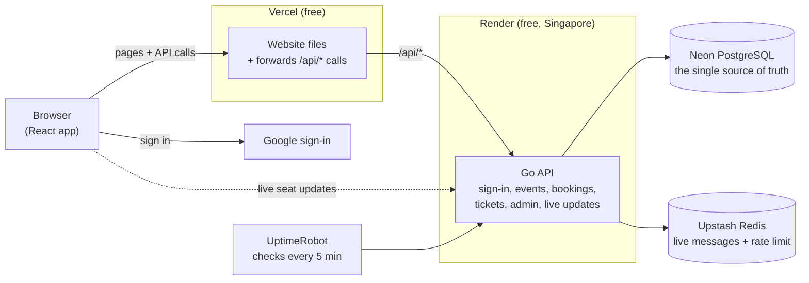
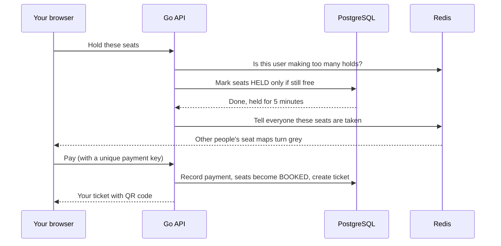

# EventHub

[](https://github.com/Badri-2915/eventhub/actions/workflows/ci.yml)

**An event ticketing website where the same seat can never be sold to two people.**

**Live demo:** https://eventhub-swart-xi.vercel.app (sign in with your Google account)

---

## The idea in simple words

You know how it works when you book a movie or a stand-up show online. You open the
seat map, pick a seat, and pay. Now imagine 200 people opening the same show at
8 pm sharp and clicking on the **same seat at the same second**. Who gets it?

In a badly built system, two people can both "win", both pay, and both turn up at the
venue with a ticket for seat C7. That is the problem I wanted to solve properly.

**EventHub** is my answer. It is a full ticketing platform:

- **Hosts** create events, design their own seating layout, set prices (or make entry free), and check people in at the door by scanning a QR code.
- **Attendees** pick seats on a live seat map. Their seats are held for 5 minutes while they pay, and then they get a QR ticket.
- **Behind the scenes**, the database decides who gets each seat. Exactly one person wins, every single time, even under heavy load. I proved this with tests and load tests (numbers below).

It is built with **Go, PostgreSQL, Redis and React**, and it runs live on free hosting for **₹0 per month**.

---

## Contents

1. [Try it yourself in 2 minutes](#try-it-yourself-in-2-minutes)
2. [What each person can do](#what-each-person-can-do)
3. [Being honest: what is real and what is not](#being-honest-what-is-real-and-what-is-not)
4. [The hard part: making sure no seat is sold twice](#the-hard-part-making-sure-no-seat-is-sold-twice)
5. [QR tickets at the door: how it works](#qr-tickets-at-the-door-how-it-works)
6. [How it is built](#how-it-is-built)
7. [Tech stack](#tech-stack)
8. [Free tools it runs on](#free-tools-it-runs-on)
9. [How many people can it handle for free?](#how-many-people-can-it-handle-for-free)
10. [Proof: tests and load tests](#proof-tests-and-load-tests)
11. [Run it on your laptop](#run-it-on-your-laptop)
12. [Settings](#settings)
13. [Folder structure](#folder-structure)
14. [What I would build next](#what-i-would-build-next)
15. [The short version](#the-short-version)

---

## Try it yourself in 2 minutes

1. Open **https://eventhub-swart-xi.vercel.app** and sign in with Google.
   - The very first visit can take a few seconds while the server wakes up.
2. Open any event. Pick seats on the seat map, or choose how many tickets you want.
   - If you open the same event in two browser windows, you can watch a seat turn grey in one window when you pick it in the other. That is the live update.
3. Click **Continue**. Your seats are now held for **5 minutes**, and you see a countdown.
4. Click **Pay**. This is a demo payment, so **no real money is taken**.
5. You get a ticket with a **QR code**. Click **Download ticket** to save it as an image.
6. Want to host? Click **Host an event → Become a host**. Create an event in 5 simple steps and publish it.
7. At the door, the host scans the guest's QR code with a normal phone camera. The page shows **"Welcome in!"** the first time and **"Already checked in"** if someone tries the same ticket again. (Details in [QR tickets at the door](#qr-tickets-at-the-door-how-it-works).)

---

## What each person can do

Everyone signs in the same way (Google). Being a host is just one click, and admin access
comes from a list of email addresses in the settings.

| Who | What they can do |
|---|---|
| **Anyone** | Browse and search events by city and type (film, comedy, music, theatre, workshop), and see live seat availability |
| **Attendee** | Pick exact seats, or a number of tickets for open seating. Seats are held for 5 minutes during checkout. Pay (demo). Get a QR ticket on screen and download it as an image. Get directions to the venue. Cancel for a full refund before the host's cutoff time |
| **Host** | Create an event in 5 steps: details, Google Maps link, seating type, tickets and review. A cover picture is added automatically based on the event type. Set a price per ticket, tick **Free entry**, or add an optional **discount %**. For seated events, design the hall on a grid (rows, aisles, blocked seats, price tiers). **Edit a live event any time**: details, prices, discounts and ticket counts. See sales live with a chart, see the attendee list, download it as CSV, check guests in with QR, delete drafts, and cancel an event (everyone is refunded automatically) |
| **Admin** | See platform totals (users, hosts, events, bookings, revenue), see every event with its host, and cancel any event with refunds |

A full walkthrough of every flow is in [docs/WORKFLOW.md](docs/WORKFLOW.md).

---

## Being honest: what is real and what is not

I prefer being clear about this upfront.

| Part | Status | What that means |
|---|---|---|
| Google sign-in | Real | Verified on the server |
| Seat holds, booking, cancelling, refunds | Real | Correct even when many people book at the same time |
| Live seat map | Real | Updates in every open browser within a second |
| QR tickets and door check-in | Real | Each ticket can be checked in only once |
| Host dashboard, CSV export, admin page | Real | |
| **Payments** | **Simulated** | **No real money moves.** The checkout has a demo "Pay" button (and a "Simulate failed payment" button to test failures). Real payment gateways like Razorpay need a registered business and KYC. Everything around payment is still built the real way: seats are held before paying, a payment can never be charged twice, and refunds are recorded. Adding Razorpay later is a small, well-defined change ([plan here](docs/WORKFLOW.md#6-payments-simulated-on-purpose)) |
| **Emails** | **Not sent** | **No emails go out right now.** Tickets live on the website and can be downloaded. The email code (ticket with QR, alert to the host, cancellation notice) is already written and tested. It is just switched off, and one setting turns it on |
| Poster upload | Hidden | Events use nice cover pictures based on their type. Upload exists in the backend, but the button is hidden for now |
| Door check-in | Real | Host-only, once per ticket, with undo, a live arrival counter, and closing after the event. No separate staff logins yet |
| Monitoring | Basic | Uptime checks every 5 minutes plus server logs. No dashboards or error tracking yet |

---

## The hard part: making sure no seat is sold twice

This is the heart of the project. Here are the real problems and how each one is handled.

**1. Two people click the same seat at the same moment.**
The database does the deciding, not the app. Booking a seat is a single instruction to
the database: *"mark this seat as held, but only if it is still free"*. Only one of the
two requests can succeed. The other gets a clear "Sorry, that seat was just taken".
If you pick 3 seats, you get all 3 or none, never just some of them.

**2. Open seating (no seat numbers), like a comedy club with 100 tickets.**
Same idea, using a counter: *"give 2 tickets only if sold + held + 2 is still within 100"*.
On top of that, the database itself has a rule that sold + held can never go above
capacity. So even a bug in my code could not oversell.

**3. People pick seats and then walk away.**
Seats are held for 5 minutes. After that they count as free again automatically.
A small background job also tidies up and tells everyone's seat map that the seat is back.

**4. Someone double-clicks "Pay", or the network retries the request.**
Every payment carries a unique key. If the same payment comes in twice, the second time
simply returns the first result. Nobody is charged twice.

**5. Two buyers want overlapping seats and get stuck waiting on each other (a deadlock).**
Seats are always locked in the same fixed order, so this cannot happen.

**6. The host cancels the event while people are in the middle of paying.**
The cancel waits for those in-progress steps, then refunds everyone and frees every seat
in one go.

**7. The host changes the price while people are booking.**
Every booking remembers the price it was held at. New prices apply only to new bookings.
The ticket count also cannot be reduced below what is already sold.

**8. Fake tickets, or the same ticket scanned twice at the door.**
Ticket codes are random. Check-in is again a single "only if not already checked in"
instruction, so even two phones scanning together give exactly one "Welcome in!".
The full door process is explained in the next section.

**9. Bots spamming holds.** Each user can make only 20 holds per minute.

**10. Keeping secrets safe.** The login session lives in a secure cookie that page scripts
cannot read. Passwords never get printed in logs, and no secret is stored in the code.

---

## QR tickets at the door: how it works

**What is inside the QR code?**
Just a web link: `https://<site>/check-in/EH-7KQ2M9XA`. The part at the end is the
**ticket code**. It is 8 random letters and digits, made with a secure random generator,
so there are about 2.8 lakh crore (2.8 trillion) possible codes. Nobody can guess a valid one.
The QR holds no name, price or personal data. Everything is checked on the server.

**The process, step by step:**

1. **Booking.** When payment succeeds, the booking gets its ticket code, and the ticket page shows the QR. The guest can also download the ticket as an image, which works offline at the venue.
2. **At the door, scan.** The host opens the normal phone camera (no special app) and points it at the guest's QR. The phone opens the check-in link.
3. **The server checks the ticket, in this order:**
   - Is the code in the right format, and does it exist?
   - Does it belong to **this host's** event? If not, the answer is "Not a ticket for your events". A host cannot even find out whether another host's ticket exists.
   - Is the booking still **confirmed**, or was it cancelled or refunded (including when the whole event was cancelled)?
   - Is the event **already over**? If yes, check-in is closed.
4. **Mark it used, exactly once.** The database runs one instruction: *"set checked-in time = now, only if it is still empty"*. The first scan wins.
5. **Show the result** in big colours that are easy to read at a busy door:
   - Green **"Welcome in!"** with the guest's name, number of tickets and seat numbers.
   - Yellow **"Already checked in"** with the time of the first scan, so staff can check the person's name.
   - Red **"Not a ticket for your events"**, **"Ticket cancelled"** or **"Event is over"**.
6. **Count.** After every scan the page shows **"Guests arrived 42 / 120"**. The host dashboard has an "Entry" column with each guest's arrival time.

**Real-world problems at the door, and how they are handled:**

| Problem | What happens |
|---|---|
| Two staff phones scan the same ticket at the same second | The database lets only one of them set the check-in time. One phone shows "Welcome in!", the other shows "Already checked in". This is covered by a test that runs both at once |
| Someone shares a screenshot of their QR with a friend | Whoever reaches the door first gets in. The second person sees "Already checked in at 7:02 pm" with the **original buyer's name**, so staff can ask for ID |
| Fake or made-up code | It is not found: "Not a ticket for your events" |
| A ticket from a different event or host | Treated exactly like a fake code. Hosts can never see each other's tickets |
| The guest cancelled and got a refund, or the event was cancelled | The booking is no longer confirmed: "Ticket cancelled" |
| Someone tries to use the ticket after the event | Check-in closes 6 hours after the end time (or 12 hours after the start if there is no end time): "Event is over" |
| Staff scan a ticket by mistake (or days before the event) | Early scans show a clear warning, and every result has an **Undo check-in** button. The ticket can then be scanned again |
| A guest scans their own QR, or the host's phone is signed out | The page explains that this is an EventHub ticket to show at the door. A signed-out host gets a "Sign in to check in" button that brings them straight back to the ticket |
| Camera not working or QR damaged | Staff type the code (shown under the QR) into the box on the check-in page |
| Weak internet at the guest's end | The downloaded ticket image works offline. Only the host's phone needs internet |

**What it does not do yet (honest list):** there are no separate staff accounts (only the
host's own login can check people in), and the door page needs internet. Staff logins and
an offline mode are good next steps.

---

## How it is built



In simple words:

- **The browser only talks to one website (Vercel).** Vercel quietly forwards every `/api/...` call to the Go server on Render. Because of this, the login cookie works safely without extra cross-site setup. The only direct connection is the live seat stream.
- **PostgreSQL is the boss.** Every booking decision happens inside the database, in one step. Redis is only a messenger that says "seat C7 just changed, update your screen". If Redis goes down, bookings still work fine and the seat map simply refreshes every 20 seconds instead.
- **The server keeps no memory of users between requests.** So if traffic grows, I can run more copies of it without changing any code.

**What happens when you book:**



**Database tables:** `users`, `events`, `ticket_categories` (prices, discounts, and counters
for open seating), `seats`, `bookings` (with ticket code and check-in time),
`booking_items` and `payments`. Changes to the tables are kept as numbered SQL files that
run automatically when the server starts.

**Backend code** (`backend/internal/`) is split by job: `auth` (sign-in and roles),
`events` (create, edit, publish, stats), `inventory` (holds, payment, cancel, expiry),
`tickets` (QR and check-in), `admin`, `realtime` (live updates), `ratelimit`,
`worker` (hold clean-up), `notify` and `mail` (emails, switched off), `db` and `httpx`.

---

## Tech stack

| Part | What I used | Why |
|---|---|---|
| Backend language | **Go 1.27** | Handles many people at the same time easily, and builds into one small, fast program |
| Web framework | **Gin** | Simple and light for routes and middleware (login checks, rate limits, logging) |
| Database | **PostgreSQL 16** | Transactions, row locks and constraints give the correctness guarantees |
| Database code | **pgx + sqlc** | I write plain SQL and sqlc turns it into type-safe Go code. No heavy ORM |
| Database changes | **golang-migrate** | Numbered SQL files, applied automatically on start-up |
| Live messages and rate limit | **Redis 7** | Sends "seat changed" to every open page, and counts holds per user |
| Live updates to the browser | **Server-Sent Events (SSE)** | A simple one-way stream from server to browser, which is all a seat map needs |
| Login | **Google sign-in + JWT** | Google confirms who you are, and our signed token sits in a secure cookie |
| QR codes | **go-qrcode** | Ticket QR images are made on the server |
| Frontend | **React 19 + TypeScript + Vite** | Typed, fast to build, fast to load |
| Design | **Tailwind CSS 4** | A calm, clean look with consistent colours and spacing |
| Data loading | **TanStack Query** | Caching, auto-refresh, and instant updates from the live stream |
| Page routing | **React Router** | Separate pages for public, attendee, host and admin |
| Testing | **Go tests (race detector) + Vitest + k6** | Unit, API and concurrency tests on a real database, frontend unit and component tests, plus load tests |
| Automatic checks | **GitHub Actions** | Runs formatting, checks, tests and the frontend build on every push |
| Packaging | **Docker** | A tiny production image, and Postgres + Redis on the laptop |
| Hosting | **Vercel, Render, Neon, Upstash** | All free plans (details below) |
| Monitoring | **UptimeRobot + Render logs** | Uptime check every 5 minutes, with an email if the site goes down |

---

## Free tools it runs on

The whole thing costs **₹0 per month**. The limits below are approximate, so check each website for the latest numbers.

| Job | Tool (free plan) | Main limits |
|---|---|---|
| Website | **Vercel** (Hobby) | About 100 GB of traffic a month, for non-commercial use |
| Go server | **Render** (Free) | 512 MB memory and a small share of one CPU. It sleeps after 15 minutes without visitors, which is why UptimeRobot pings it |
| Database | **Neon** (Free) | 0.5 GB of storage. The database sleeps when nobody is using it, with roughly 100 compute-hours a month |
| Redis | **Upstash** (Free) | About 500,000 commands a month |
| Sign-in | **Google** | Free, with no user limit once the app is published |
| Uptime | **UptimeRobot** (Free) | Checks every 5 minutes and emails if the site is down |
| Code and automatic checks | **GitHub + GitHub Actions** | Free for public projects |

A small detail I am happy with: UptimeRobot calls a special `/api/ping` address that
**does not touch the database**, and the clean-up job skips the database when nobody is
booking. So the server stays awake for fast pages, but the free database can still sleep
and save its monthly hours.

---

## How many people can it handle for free?

These are honest **estimates**. They are based on what I measured plus the free-plan limits.

| Question | Rough answer |
|---|---|
| How many people can sign up? | **1,00,000+** users. Each user takes very little space, so this is not the limit |
| How many bookings can be stored? | Around **2,00,000 bookings and 1,000 events** before the 0.5 GB database fills up |
| How many bookings per month? | Around **25,000 to 30,000** (about 1,000 a day). Redis messages run out first |
| How many people browsing at the same time? | **Measured: 50 people at once with zero errors**, with most pages answered in about a tenth of a second (95% within 117 ms), and the server was not even at full load. Realistically around 100 to 200 active people at once |
| How fast can it sell during a rush? | On my laptop the same code handled **~350 bookings per second**. On the free server, expect tens per second. That is plenty for a college fest or a 500-seat hall selling out in minutes |

**In short:** the free setup is perfect for a demo, a portfolio, or small real events like
a college fest, a comedy club or a 300 to 500 seat venue. For a huge launch with thousands
of buyers in the same second, you just move to paid plans. **No code changes are needed.**

---

## Proof: tests and load tests

| Test | Result |
|---|---|
| **1,000** people click the same seat at the same moment (Go test) | Exactly **1** wins, 999 are told "taken" |
| **1,000** people grab two side-by-side seats in a 200-seat hall at once, many pairs overlapping (Go test) | **0** seats sold twice, **0** half bookings, **0** deadlocks |
| **1,000** people try to buy 100 open-seating tickets at once (Go test) | Exactly **100** sold, never more |
| **2,500** payment requests at once: 50 bookings, each "Pay" sent 50 times (Go test) | Exactly **50** payments, nobody charged twice |
| Two phones scan the same QR code together (Go test) | Exactly **1** check-in, the other sees "Already checked in" |
| Undo, scan again, then scan after the event ends (Go test) | Undo works, re-scan works, after the event it is refused |
| 200 users fight for one seat (k6 load test, on my laptop) | 1 wins, 199 are told "taken", **0 errors** |
| 300 users try to buy 100 tickets (k6, on my laptop) | Exactly **100 sold**, never more |
| 200 users keep booking for 60 seconds (k6, on my laptop) | **~350 bookings per second**, about 1,050 requests per second, **0% errors** |
| 50 people browsing the **live** free website (k6) | About 64 requests per second, **0% errors**, 95% answered within 117 ms |

There are **70 automated tests**, and GitHub Actions runs all of them on every push:

| Kind | How many | What they check |
|---|---|---|
| Go unit tests | 14 | Session tokens (tampered, expired, wrong key and `alg: none` tokens are refused), settings checks (a bad setting never prints a password), discount maths, map links, the seating layout |
| Go API tests | 6 | The **real** API over HTTP with a real database and Redis: sign-in and roles, every error code, hold → pay → ticket, paying twice, someone else's ticket, releasing seats, door check-in, cancellations and refunds, the "20 holds a minute" limit |
| Go concurrency and database tests | 19 | Seat races, overlapping seats, overselling, double payment, hold expiry, cancelling while people book, check-in only once, live price edits, free tickets |
| Frontend tests (Vitest) | 31 | Prices and discounts (must match the server to the paisa), seat numbering, the ticket picker's limits, price labels |

Every Go test runs with Go's **race detector**, against a real PostgreSQL (no mocks), because
the bugs that matter here live in locking and SQL. Full load test details are in
[loadtest/RESULTS.md](loadtest/RESULTS.md).

---

## Run it on your laptop

**One-time setup (macOS):**

```bash
brew install go node sqlc colima docker docker-compose k6
colima start --cpu 2 --memory 4
cp backend/.env.example backend/.env       # then set JWT_SECRET: openssl rand -base64 48
cd frontend && npm install && cd ..
```

**Every time**, open three terminals inside the `eventhub/` folder (after restarting your
Mac, run `colima start` first):

```bash
make up && make seed     # starts Postgres + Redis and adds 5 demo events
make api                 # Go server on port 8080
make web                 # website on http://localhost:5173
```

Open http://localhost:5173 and use **Developer sign-in** with any email. It only exists on
your laptop, never on the live site. Sign in as `admin@eventhub.dev` to see the Admin page.

| Command | What it does |
|---|---|
| `make up` / `make down` | Start / stop Postgres and Redis |
| `make db-reset` then `make seed` | Wipe the local database and reload the demo events |
| `make test` | Run all Go tests (with the race detector) and the frontend tests |
| `make loadtest` | Run the k6 load tests (start the API with `HOLD_RATE_PER_MIN=1000000 make api` first) |
| `make sqlc` | Regenerate the database code after changing `backend/queries/*.sql` |

---

## Settings

| Setting | On your laptop | On the live site | Where it comes from |
|---|---|---|---|
| `DATABASE_URL` | already set (Docker) | needed (Render) | Neon, using the direct connection string |
| `REDIS_URL` | already set (Docker) | needed (Render) | Upstash (`rediss://…`) |
| `JWT_SECRET` | in `.env` | Render creates it | — |
| `GOOGLE_CLIENT_ID` | optional | needed (Render) | Google Cloud, OAuth client ID |
| `FRONTEND_ORIGIN` | already set | needed (Render) | The Vercel website address, with no `/` at the end. Used for QR links and live updates |
| `ADMIN_EMAILS` | `admin@eventhub.dev` | needed (Render) | Your own Gmail |
| `VITE_GOOGLE_CLIENT_ID` | optional | needed (Vercel) | The same Google client ID |
| `VITE_STREAM_BASE` | not needed | needed (Vercel) | `https://<render-app>.onrender.com/api` |
| `BREVO_API_KEY`, `MAIL_FROM` | not needed | not set (emails are off) | Brevo, for later |

Secrets live only in the Render and Vercel dashboards, and in local files that git ignores.
**Nothing secret is in this repository.** The step-by-step free deployment guide is in
[docs/DEPLOY.md](docs/DEPLOY.md).

---

## Folder structure

```
backend/     Go server
  cmd/api          the server
  cmd/seed         adds demo events
  internal/        auth, events, inventory, tickets, admin, realtime, ratelimit, worker, notify, mail, db, httpx
  internal/server  builds every route (used by the server and by the API tests)
  migrations/      numbered SQL files for the database
  queries/         SQL used by sqlc
  tests/           API, concurrency and real-database tests
frontend/    React website
  src/pages/       public, host and admin pages
  src/components/  seat map, layout designer, cards and more
  public/covers/   cover pictures for each event type
loadtest/    k6 load tests and results
docs/        WORKFLOW.md (how everything works), DEPLOY.md (free hosting guide), PLAN.md (original design)
render.yaml  Render setup     .github/workflows/ci.yml  automatic checks
```

---

## What I would build next

| Next step | Why | Tool (free option) |
|---|---|---|
| Real payments | Replace the demo payment with real money | Razorpay (test mode first) |
| Emails | Send the ticket with QR to the buyer, alert the host, notify cancellations. Already written, just switched on with a key | Brevo (300 emails a day free) |
| Door staff logins | Let the host add helpers who can scan tickets without the host's own account | Code change |
| Offline door mode | Keep checking in for a short time if the venue's internet drops, then sync | Code change |
| Error tracking | Get an alert with full details whenever something crashes | Sentry |
| Dashboards | Graphs of traffic, speed, holds and bookings per minute | Prometheus + Grafana Cloud |
| Browser tests | Automatically click through booking and check-in on every push | Playwright |
| Poster upload | Let hosts upload their own event picture | Cloudinary |
| Very big ticket rushes | Split the ticket counter into parts, and add a waiting room for huge launches | Code change |
| More scale | Paid server (no sleeping, more CPU), always-on database, more server copies | Paid plans, no code changes |

---

## The short version

If you only read one section, read this one:

- **What it is:** a full event ticketing platform with live seat maps, 5-minute seat holds, QR tickets, door check-in, a host dashboard and an admin page.
- **The hard problem it solves:** many people clicking the same seat at the same moment, and still **never selling a seat twice**. The database decides in one step, and a safety rule inside the database backs it up.
- **The proof:** 70 automated tests run on every push. 1,000 requests for one seat give exactly 1 winner; 1,000 buyers fighting over overlapping seats give 0 double bookings and 0 deadlocks; 1,000 buyers for 100 tickets give exactly 100 sold; and the laptop test sustained **~350 bookings per second with 0 errors**. The live free site served 50 people at once with 0 errors.
- **What is honest:** payments are a demo (no real money), and emails are written but switched off. Both are clearly planned next steps.
- **What it costs:** **₹0 a month**, running live on Vercel, Render, Neon and Upstash.

Thanks for reading. If you try the live demo, open the same event in two windows and
watch the seats change in real time.
