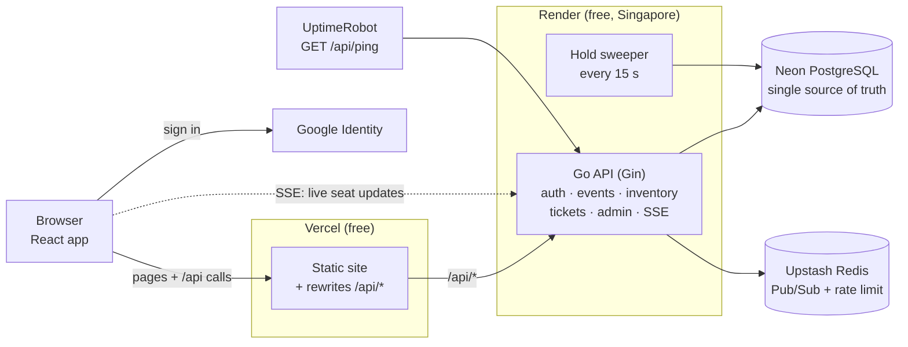
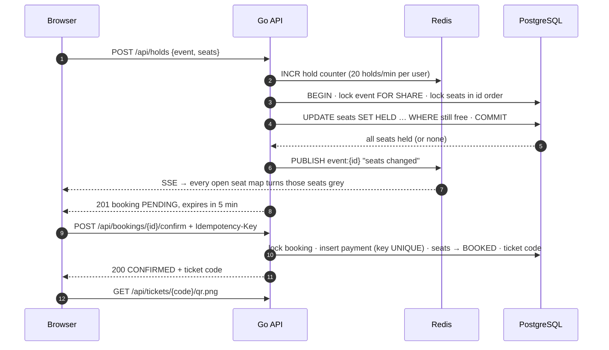
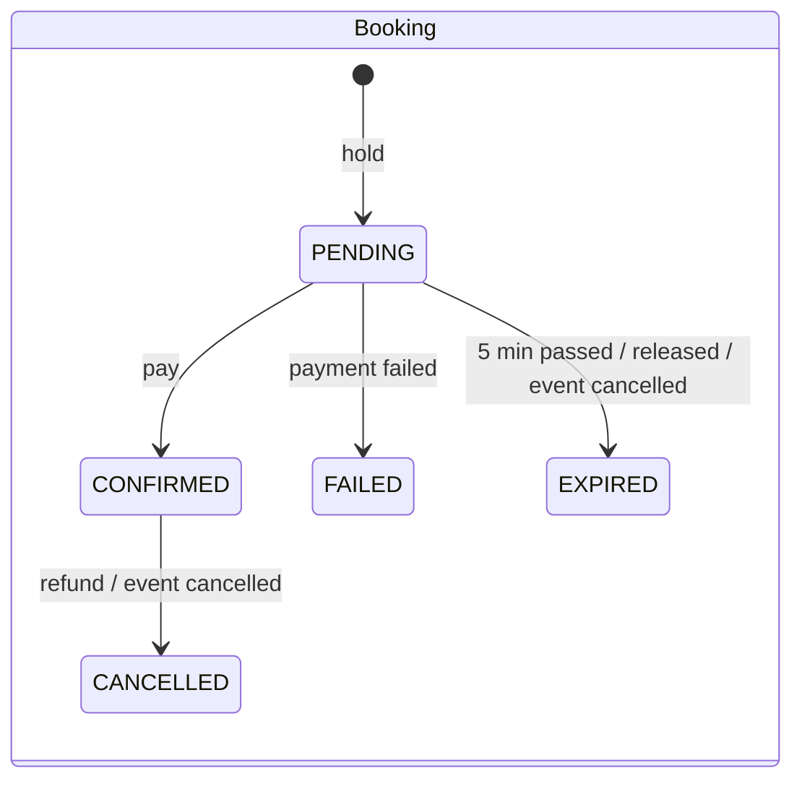
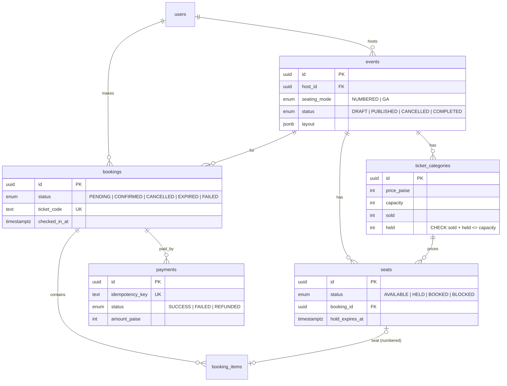

<div align="center">

# EventHub

**A live event ticketing platform where the same seat can never be sold to two people.**

[](https://github.com/Badri-2915/eventhub/actions/workflows/ci.yml)


### [Live demo: eventhub-swart-xi.vercel.app](https://eventhub-swart-xi.vercel.app)

Sign in with Google · Pick a seat · Pay (demo) · Get a QR ticket · Scan it at the door

</div>

---

## At a glance

| | |
|---|---|
| **The problem** | 1,000 people click the same seat at the same second. Exactly **one** must get it, and nobody may be charged twice. |
| **The idea** | Let **PostgreSQL** decide, in one atomic statement, with row locks taken in a fixed order and `CHECK` constraints as the last line of defence. |
| **Real-time** | Every open seat map updates within a second through **Server-Sent Events + Redis Pub/Sub**. |
| **The proof** | **70 automated tests** on every push. 1,000-way seat race → exactly 1 winner. 2,500 payment requests at once → each booking paid exactly once. 0 deadlocks. |
| **Load** | **~350 bookings/s** with **0% errors** (k6, laptop). Live free site: 50 users at once, p95 117 ms. |
| **Cost** | **₹0/month** on Vercel, Render, Neon and Upstash free plans. |

---

## Contents

1. [The story behind it](#the-story-behind-it)
2. [Try it in 2 minutes](#try-it-in-2-minutes)
3. [Features](#features)
4. [What is real and what is simulated](#what-is-real-and-what-is-simulated)
5. [Architecture](#architecture)
6. [A booking, end to end](#a-booking-end-to-end)
7. [How double booking is prevented](#how-double-booking-is-prevented)
8. [QR tickets and door check-in](#qr-tickets-and-door-check-in)
9. [Data model](#data-model)
10. [API reference](#api-reference)
11. [Tech stack](#tech-stack)
12. [Testing](#testing)
13. [Load testing](#load-testing)
14. [Run it locally](#run-it-locally)
15. [Configuration](#configuration)
16. [Deployment (₹0/month)](#deployment-0month)
17. [How far the free plan goes](#how-far-the-free-plan-goes)
18. [Project structure](#project-structure)
19. [Roadmap](#roadmap)
20. [TL;DR](#tldr)

---

## The story behind it

You know how booking a movie or a stand-up show works: open the seat map, pick a seat,
pay. Now picture a popular show going on sale at **8 pm sharp**. Hundreds of people open
the page and click **the same seat in the same second**.

A naive system does *"check if the seat is free → then save the booking"*. Between the
check and the save, someone else does the same check. Both see "free", both save, both
pay, and two people walk up to the venue holding a ticket for seat **C7**.

EventHub is built so that this **cannot** happen, not "rarely happens". The database is
the single referee, every booking step is one atomic decision, and the claim is backed by
tests that throw 1,000 concurrent buyers at a single seat.

Around that core, it is a complete product: hosts design halls and sell tickets, buyers get
QR tickets, and hosts scan them at the door.

---

## Try it in 2 minutes

1. Open **https://eventhub-swart-xi.vercel.app** and sign in with Google.
   *The first visit may take a few seconds while the free server wakes up.*
2. Open any event and pick seats on the seat map (or choose a number of tickets for open seating).
   > **Tip:** Open the **same event in two browser windows**. Pick a seat in one and watch it turn grey in the other, live.
3. Click **Continue**. Your seats are now **held for 5 minutes**, with a countdown.
4. Click **Pay**. It's a demo payment, so **no real money moves**.
5. Your ticket appears with a **QR code**. Click **Download ticket** to save it as an image.
6. Want to host? **Host an event → Become a host**, then create and publish an event in 5 steps.
7. At the door, the host scans the QR with a normal phone camera: **"Welcome in!"** the first time, **"Already checked in"** after that.

---

## Features

Everyone signs in the same way (Google). Becoming a host is one click, and admins are a
list of email addresses in the server settings.

<table>
<tr><th width="18%">Who</th><th>What they can do</th></tr>
<tr><td><b>Anyone</b></td><td>Browse and search events by city and type (film, comedy, music, theatre, workshop) and see live availability.</td></tr>
<tr><td><b>Attendee</b></td><td>
Pick exact seats on a live map, or a number of tickets for open seating ·
5-minute seat hold with countdown · Pay (demo) and get a QR ticket ·
download the ticket as an image · get directions to the venue ·
cancel for a full refund before the host's cutoff time.
</td></tr>
<tr><td><b>Host</b></td><td>
Create an event in 5 steps (details → Google Maps link → seating → tickets → review) ·
a cover picture is chosen automatically from the event type ·
paid tickets, <b>free entry</b>, or a <b>discount %</b> ·
design a seated hall on a grid (rows, aisles, blocked seats, price tiers) ·
<b>edit a live event</b> (details, prices, discounts, ticket counts) ·
live sales chart · attendee list with CSV export ·
QR door check-in with undo and a live arrival counter ·
delete drafts · cancel an event (everyone is refunded automatically).
</td></tr>
<tr><td><b>Admin</b></td><td>Platform totals (users, hosts, events, bookings, revenue), every event with its host, and cancel any event with refunds.</td></tr>
</table>

Every screen and flow is walked through in **[docs/WORKFLOW.md](docs/WORKFLOW.md)**.

---

## What is real and what is simulated

I prefer to be upfront about this.

| Part | Status | Notes |
|---|---|---|
| Google sign-in | Real | The Google ID token is verified on the server |
| Holds, booking, cancelling, refunds | Real | Correct under heavy concurrency (see [Testing](#testing)) |
| Live seat map | Real | Every open browser updates within about a second |
| QR tickets and door check-in | Real | Each ticket checks in exactly once |
| Host dashboard, CSV export, admin page | Real | |
| **Payments** | **Simulated** | **No real money moves.** Checkout has a demo **Pay** button and a **Simulate failed payment** button. A real gateway such as Razorpay needs a registered business and KYC. Everything *around* payment is built the real way: seats are held before paying, a payment can never be charged twice, and refunds are recorded. Adding Razorpay is a small, well-defined change ([plan](docs/WORKFLOW.md#6-payments-simulated-on-purpose)) |
| **Emails** | **Off** | The email code (ticket with QR, host alert, cancellation notice) is written and tested, but switched off. One setting turns it on |
| Poster upload | Hidden | Implemented in the backend; the button is hidden and events use type-based cover pictures |
| Monitoring | Basic | Uptime checks every 5 minutes plus server logs. No dashboards or error tracking yet |

---

## Architecture



**Design principles**

- **PostgreSQL is the referee.** Every decision that matters (who gets a seat, whether a payment already happened, whether a ticket was already scanned) is one atomic SQL statement inside a transaction. Redis never decides anything.
- **Redis is only a messenger.** After a change, the API publishes "seats C7, C8 changed" on a per-event channel, and every API instance pushes it to its SSE clients. If Redis is down, bookings still work and the seat map falls back to polling every 20 seconds.
- **The API is stateless.** Sessions are signed JWTs in an `HttpOnly` cookie, so more API instances can be added without code changes.
- **One origin for the browser.** Vercel forwards `/api/*` to Render, so the session cookie is first-party. Only the SSE stream connects to Render directly.
- **Lazy expiry + a sweeper.** An expired hold already counts as free inside the hold query itself. A background sweeper (`FOR UPDATE SKIP LOCKED`) cleans up and tells seat maps the seats are back. It also skips the database entirely when nobody is booking, so the free database can sleep.

---

## A booking, end to end



**Lifecycles**



A seat moves `AVAILABLE → HELD → BOOKED`, and goes back to `AVAILABLE` on expiry, failure
or cancellation. `BLOCKED` seats (pillars, aisles) are never sellable.

---

## How double booking is prevented

This is the heart of the project.

### 1. Numbered seats: one conditional update

```sql
-- Lock target rows in id order (prevents deadlocks between overlapping holds),
-- then one check-and-set: only free or expired seats match.
WITH target AS (
    SELECT t.id FROM seats t
    WHERE t.event_id = $event AND t.id = ANY($seat_ids)
    ORDER BY t.id
    FOR UPDATE
)
UPDATE seats s
SET status = 'HELD', booking_id = $booking, hold_expires_at = $expires
FROM target
WHERE s.id = target.id
  AND (s.status = 'AVAILABLE' OR (s.status = 'HELD' AND s.hold_expires_at < now()))
RETURNING s.id;
```

If fewer rows come back than were asked for, the transaction rolls back. You get **all
your seats or none**, never half a booking. The loser gets a clean `409 SEATS_TAKEN`.

### 2. Open seating: a guarded counter, backed by a constraint

```sql
UPDATE ticket_categories SET held = held + $qty
WHERE id = $category AND capacity - sold - held >= $qty;

-- and in the schema, so even a bug cannot oversell:
CHECK (capacity IS NULL OR sold + held <= capacity)
```

### 3. Every tricky case, handled

| # | Situation | How it is handled |
|---|---|---|
| 1 | Two people click the same seat | One conditional `UPDATE`; the database lets exactly one win |
| 2 | Overlapping multi-seat holds (A1–A3 vs A3–A5) | Rows locked in **id order**, so no deadlock; all-or-nothing |
| 3 | Open seating rush | Guarded counter + `CHECK (sold + held <= capacity)` |
| 4 | People hold seats and walk away | 5-minute holds; expired holds count as free immediately; a `SKIP LOCKED` sweeper tidies up |
| 5 | Double-click on **Pay**, or a network retry | `Idempotency-Key` header, `UNIQUE` in the database, checked after locking the booking; a repeat returns the same result |
| 6 | Host cancels while people are paying | Holds take `FOR SHARE` on the event, cancel takes `FOR UPDATE`: cancel waits, then refunds everyone in one transaction |
| 7 | Host changes the price mid-sale | Each booking stores the price it was held at; capacity can't drop below sold + held |
| 8 | One user opens many holds | Partial unique index: one `PENDING` booking per user per event |
| 9 | Bots spamming holds | Redis rate limit: 20 holds per minute per user |
| 10 | Same QR scanned twice at once | `SET checked_in_at = now() WHERE checked_in_at IS NULL`; exactly one "Welcome in!" |
| 11 | Session theft / tampering | Signed JWT in an `HttpOnly`, `SameSite=Lax` cookie (`Secure` in production); tampered, expired and `alg: none` tokens are rejected |

---

## QR tickets and door check-in

**What's in the QR?** Only a link: `https://<site>/check-in/EH-7KQ2M9XA`. The code is 8
random characters from a cryptographic generator, about **2.8 trillion** possibilities, so
nobody can guess a valid one. No name, price or personal data is inside; everything is
checked on the server.

**What the server checks, in order:**

1. Does the code exist?
2. Does it belong to **this host's** event? A host can't even learn whether another host's ticket exists.
3. Is the booking still **confirmed** (not cancelled or refunded)?
4. Is the event **not over yet**? Check-in closes 6 hours after the end time, or 12 hours after the start if there is no end time.
5. Mark it used **exactly once**, then show a big, clear result:
   **Welcome in!** (green) (name, tickets, seats) · **Already checked in at 7:02 pm** (yellow) · **Not your event / Cancelled / Event is over** (red)

| Real-world problem at the door | What happens |
|---|---|
| Two staff phones scan the same ticket together | Only one sets the check-in time; the other sees "Already checked in" (covered by a test) |
| Someone shares a screenshot of their QR | First person in wins; the second sees the **original buyer's name** so staff can check ID |
| A fake code, or a ticket for another host's event | "Not a ticket for your events" |
| Scanned by mistake | Every result has **Undo check-in** |
| Camera fails or QR is damaged | Type the code shown under the QR |
| Guest has no internet | The downloaded ticket image works offline; only the host's phone needs internet |

After every scan the page shows **"Guests arrived 42 / 120"**, and the host dashboard has an
arrival-time column.

---

## Data model



- Money is always **integer paise** (₹500 = `50000`), never floating point.
- Schema changes are numbered SQL migrations (`backend/migrations/`) applied automatically on start-up with **golang-migrate**.
- Queries are plain SQL in `backend/queries/`, turned into type-safe Go by **sqlc**.

---

## API reference

All routes live under `/api`. Errors always have the same shape:
`{"error": {"code": "SEATS_TAKEN", "message": "Some of those seats were just taken…"}}`.

<details>
<summary><b>Show all 37 routes</b></summary>

| Method | Path | Who | Purpose |
|---|---|---|---|
| `GET` `HEAD` | `/ping` | anyone | Liveness for uptime checks (touches no database) |
| `GET` | `/healthz` | anyone | Checks PostgreSQL and Redis |
| `POST` | `/auth/google` | anyone | Exchange a Google ID token for a session cookie |
| `POST` | `/auth/logout` | anyone | Clear the session |
| `POST` | `/auth/dev` | anyone, **local only** | Developer sign-in (not registered in production) |
| `GET` | `/me` | signed in | Current user |
| `POST` | `/me/become-host` | signed in | Turn on hosting |
| `GET` | `/events` | anyone | Search published events |
| `GET` | `/events/cities` | anyone | Cities with events |
| `GET` | `/events/:id` | anyone | Event details and ticket types |
| `GET` | `/events/:id/seats` | anyone | Seat map with live status |
| `GET` | `/events/:id/stream` | anyone | **SSE** stream of seat changes |
| `GET` | `/tickets/:code/qr.png` | anyone | QR image for a ticket |
| `POST` | `/holds` | signed in | Hold seats or GA tickets (rate limited) |
| `DELETE` | `/holds/:id` | signed in | Release a hold |
| `GET` | `/bookings/:id` | owner | Booking details |
| `POST` | `/bookings/:id/confirm` | owner | Pay; needs an `Idempotency-Key` header |
| `POST` | `/bookings/:id/cancel` | owner | Cancel and refund (before the cutoff) |
| `GET` | `/me/bookings` | signed in | My tickets |
| `GET` `POST` | `/host/events` | host | List / create my events |
| `GET` `PUT` `DELETE` | `/host/events/:id` | host | Read / edit (also live) / delete a draft |
| `POST` | `/host/events/:id/publish` | host | Publish |
| `POST` `PUT` | `/host/events/:id/poster` | host | Poster upload (signature / save) |
| `GET` | `/host/events/:id/stats` | host | Live sales numbers |
| `GET` | `/host/events/:id/attendees` | host | Attendee list |
| `GET` | `/host/events/:id/attendees.csv` | host | Attendee CSV |
| `POST` | `/host/events/:id/cancel` | host | Cancel the event and refund everyone |
| `POST` `DELETE` | `/host/check-in/:code` | host | Check in / undo check-in |
| `GET` | `/admin/overview` | admin | Platform totals |
| `GET` | `/admin/events` | admin | Every event with its host |
| `POST` | `/admin/events/:id/cancel` | admin | Cancel any event with refunds |

**Common error codes:** `SEATS_TAKEN` (409), `NOT_ENOUGH_TICKETS` (409), `HOLD_EXPIRED` (410),
`HOLD_IN_PROGRESS` (409), `IDEMPOTENCY_KEY_REQUIRED` (400), `IDEMPOTENCY_KEY_REUSED` (409),
`CANCEL_WINDOW_CLOSED` (409), `TICKET_NOT_FOUND` (404), `TICKET_NOT_VALID` (410),
`CHECK_IN_CLOSED` (409), `TRY_AGAIN` (409), `RATE_LIMITED` (429), plus 401/403 for sign-in and roles.

</details>

---

## Tech stack

| Layer | Choice | Why |
|---|---|---|
| Language | **Go 1.27** | Cheap goroutines for many concurrent requests; one small static binary |
| HTTP | **Gin** | Light routing and middleware (auth, roles, rate limit, logging, recovery) |
| Database | **PostgreSQL 16** | Transactions, row locks and constraints give the correctness guarantees |
| DB access | **pgx + sqlc** | Plain SQL compiled into type-safe Go; no ORM magic around locking |
| Migrations | **golang-migrate** | Numbered up/down SQL files, applied on start-up |
| Messaging & limits | **Redis 7** | Pub/Sub for seat changes; per-user hold rate limit |
| Real-time | **Server-Sent Events** | One-way server → browser stream; all a seat map needs |
| Auth | **Google Identity + JWT** | Google proves who you are; a signed token sits in an `HttpOnly` cookie |
| QR | **go-qrcode** | Ticket QR images generated on the server |
| Frontend | **React 19 + TypeScript + Vite** | Typed, fast to build and to load |
| Styling | **Tailwind CSS 4** | Consistent colours and spacing |
| Data fetching | **TanStack Query** | Caching, refetching, and cache updates from the SSE stream |
| Routing | **React Router** | Public, attendee, host and admin areas |
| Tests | **Go test (`-race`) · Vitest · Testing Library · k6** | Unit, API, concurrency, component and load tests |
| CI | **GitHub Actions** | `gofmt`, `go vet`, all tests and the frontend build on every push |
| Packaging | **Docker** | Small production image; Postgres + Redis locally |

---

## Testing

There are **70 automated tests**, and GitHub Actions runs every one of them on every push
and pull request.

**What "70 tests" means:** 70 test *cases* (39 in Go, 31 in the frontend), each checking one
behaviour end to end. Together they contain **238 checks**, and a single concurrency test can
fire **1,000 or 2,500 simultaneous requests**. So the count is small on purpose: each test is
a full scenario, not a one-line assertion.

| Kind | Count | How it runs | What it proves |
|---|---|---|---|
| **Go unit** | 14 | Calls functions directly | Session tokens (tampered, expired, wrong-key and `alg: none` are refused), config validation never leaks a secret, discount maths, map links, seat-layout generation |
| **Go API** | 6 | Starts the **real router** (`server.New`, the same function `main.go` uses) on `httptest.NewServer` and sends **real HTTP requests**; each client has its own cookie jar, so one test can be a buyer, a rival, a host and an admin at once | Sign-in and roles, every error code, hold → pay → ticket, paying twice, other people's bookings, releasing seats, check-in, cancellations and refunds, the 20-holds-per-minute limit |
| **Go concurrency & database** | 19 | Up to **1,000 goroutines** wait on a start channel, then hit the booking service at the same instant against a **real PostgreSQL** (40 pooled connections) | Seat races, overlapping seats, oversell, double payment, hold expiry and takeover, cancel during checkout, one-time check-in, live price edits, free tickets |
| **Frontend** | 31 | **Vitest + Testing Library** in jsdom (a browser-like DOM in Node); clicks are real user events | Prices and discounts match the server to the paisa, seat numbering, the ticket picker's limits, price labels |

**Headline results**

| Scenario | Result |
|---|---|
| **1,000** buyers click the same seat at the same moment | Exactly **1** hold, 999 × `SEATS_TAKEN` |
| **1,000** buyers grab overlapping seat pairs in a 200-seat hall | **0** double bookings, **0** half bookings, **0** deadlocks, **0** `TRY_AGAIN` |
| **1,000** buyers for **100** open-seating tickets | Exactly **100** sold |
| **2,500** payment requests at once (50 bookings × 50 duplicates) | Exactly **50** payments, nobody charged twice |
| Two phones scan the same QR together | Exactly **1** check-in |

Every Go test runs with Go's **race detector**, against a real PostgreSQL and Redis (no
mocks), because the bugs that matter here live in locking and SQL. Locally the tests use a
separate `eventhub_test` database, created and migrated automatically.

---

## Load testing

[k6](https://k6.io) scripts in [`loadtest/`](loadtest/) send real HTTP traffic to a running
API.

| Test | Where | Result |
|---|---|---|
| 200 users race for one seat | Laptop | 1 winner, 199 × 409, p95 140 ms, **0 errors** |
| 300 buyers for 100 GA tickets | Laptop | Exactly **100 sold**, p95 301 ms |
| 200 users booking for 60 s | Laptop | **~350 bookings/s**, ~1,050 req/s, hold p95 193 ms, confirm p95 311 ms, **0% errors** |
| 50 users browsing the **live** site | Free hosting | ~64 req/s, **0% errors**, p95 117 ms |

Full numbers and method: **[loadtest/RESULTS.md](loadtest/RESULTS.md)**.

---

## Run it locally

**Prerequisites (macOS):**

```bash
brew install go node sqlc colima docker docker-compose k6
colima start --cpu 2 --memory 4
```

**One-time setup:**

```bash
git clone https://github.com/Badri-2915/eventhub.git && cd eventhub
cp backend/.env.example backend/.env      # then set JWT_SECRET: openssl rand -base64 48
cd frontend && npm install && cd ..
```

**Every time** (three terminals in `eventhub/`; after a reboot, run `colima start` first):

```bash
make up && make seed     # Postgres + Redis in Docker, plus 5 demo events
make api                 # Go API on :8080 (migrations run on start)
make web                 # website on http://localhost:5173
```

Open http://localhost:5173 and use **Developer sign-in** with any email. It exists only
locally, never in production. Sign in as `admin@eventhub.dev` to see the admin page.

| Command | What it does |
|---|---|
| `make up` / `make down` | Start / stop Postgres and Redis |
| `make db-reset && make seed` | Wipe the local database and reload demo events |
| `make test` | All Go tests with `-race`, then all frontend tests |
| `make loadtest` | k6 race, oversell and 60 s load tests (start the API with `HOLD_RATE_PER_MIN=1000000 make api`) |
| `make sqlc` | Regenerate Go code after editing `backend/queries/*.sql` |

---

## Configuration

| Variable | Local | Production | Notes |
|---|---|---|---|
| `DATABASE_URL` | preset (Docker) | Render | Neon **direct** connection string |
| `REDIS_URL` | preset (Docker) | Render | Upstash `rediss://…` |
| `JWT_SECRET` | `.env` | Render (generated) | At least 32 bytes |
| `GOOGLE_CLIENT_ID` | optional | Render | Google Cloud OAuth client ID |
| `FRONTEND_ORIGIN` | preset | Render | Site URL without a trailing `/`; used for QR links and SSE CORS |
| `ADMIN_EMAILS` | `admin@eventhub.dev` | Render | Comma-separated |
| `HOLD_MINUTES` | `5` | `5` | Hold length |
| `HOLD_RATE_PER_MIN` | `20` | `20` | Holds per user per minute |
| `VITE_GOOGLE_CLIENT_ID` | optional | Vercel | Same Google client ID |
| `VITE_STREAM_BASE` | not needed | Vercel | `https://<render-app>.onrender.com/api` |
| `BREVO_API_KEY`, `MAIL_FROM` | not needed | unset (emails off) | For turning emails on later |

Secrets live only in the Render and Vercel dashboards and in git-ignored local files.
**Nothing secret is committed to this repository.**

---

## Deployment (₹0/month)

| Job | Service (free plan) | Main limits |
|---|---|---|
| Website | **Vercel** Hobby | ~100 GB traffic/month, non-commercial |
| Go API | **Render** Free (`render.yaml`) | 512 MB RAM, shared CPU, sleeps after 15 min idle |
| Database | **Neon** Free | 0.5 GB storage, scales to zero, ~100 compute-hours/month |
| Redis | **Upstash** Free | ~500K commands/month |
| Sign-in | **Google Identity** | Free |
| Uptime | **UptimeRobot** Free | Pings every 5 minutes, emails on downtime |
| CI | **GitHub Actions** | Free for public repos |

A small detail I like: UptimeRobot pings `/api/ping`, which **touches neither PostgreSQL
nor Redis**, and the sweeper skips the database when nobody is booking. The API stays
awake for fast pages, while the free database can still sleep and save its monthly hours.

Step-by-step guide: **[docs/DEPLOY.md](docs/DEPLOY.md)**.

---

## How far the free plan goes

Honest estimates, based on measurements plus the free-plan limits:

| Question | Rough answer |
|---|---|
| Registered users | **1,00,000+**; storage per user is tiny |
| Stored bookings | ~**2,00,000 bookings and 1,000 events** before 0.5 GB fills up |
| Bookings per month | ~**25,000–30,000**; the Redis command quota runs out first |
| People browsing at once | **Measured: 50 with 0 errors** (p95 117 ms); realistically 100–200 |
| Booking rush | ~350/s on a laptop; **tens per second** on the free server |

That's plenty for a college fest, a comedy club or a 300–500 seat hall. For a national-scale
launch, move to paid plans, add more API instances, shard hot GA counters and add a
waiting room. **No changes to the core code are needed.**

---

## Project structure

```
eventhub/
├── backend/                  Go API
│   ├── cmd/api/              entry point (server + hold sweeper)
│   ├── cmd/seed/             demo events
│   ├── internal/
│   │   ├── server/           builds every route (shared by main.go and the API tests)
│   │   ├── auth/             Google sign-in, JWT cookie, roles
│   │   ├── events/           create, edit, publish, stats, attendees
│   │   ├── inventory/        holds, payment, cancel, refunds, expiry
│   │   ├── tickets/          QR codes and door check-in
│   │   ├── realtime/         Redis Pub/Sub → SSE hub
│   │   ├── ratelimit/        per-user Redis limiter
│   │   ├── worker/           hold sweeper (SKIP LOCKED)
│   │   ├── admin/  notify/  mail/  config/  db/  httpx/
│   ├── migrations/           numbered SQL migrations
│   ├── queries/              SQL for sqlc
│   └── tests/                API, concurrency and stress tests
├── frontend/                 React + TypeScript (Vite)
│   ├── src/pages/            public, attendee, host and admin pages
│   ├── src/components/       seat map, layout designer, ticket picker…
│   ├── src/lib/              API client, money and layout helpers (+ tests)
│   └── public/covers/        cover pictures per event type
├── loadtest/                 k6 scripts and RESULTS.md
├── docs/                     WORKFLOW.md · DEPLOY.md · PLAN.md
├── .github/workflows/ci.yml  CI
├── docker-compose.yml        local Postgres + Redis
├── render.yaml               Render blueprint
└── Makefile
```

---

## Roadmap

| Next step | Why | Tool |
|---|---|---|
| Real payments | Replace the demo with real money (webhook-confirmed) | Razorpay (test mode first) |
| Emails | Ticket with QR, host alerts, cancellations (already written) | Brevo |
| Door staff accounts | Helpers can scan without the host's login | Code change |
| Offline door mode | Keep checking in when venue internet drops, sync later | Code change |
| Error tracking | Alerts with stack traces | Sentry |
| Metrics dashboards | Traffic, latency, holds and bookings per minute | Prometheus + Grafana |
| Browser end-to-end tests | Click through booking and check-in on every push | Playwright |
| Huge on-sales | Sharded GA counters and a waiting room | Code change + Redis |

---

## TL;DR

- **What:** a full ticketing platform with live seat maps, 5-minute holds, QR tickets, door check-in, host dashboards and an admin page.
- **Hard part:** many people clicking the same seat at once, and still **never selling it twice**. PostgreSQL decides in one atomic statement, with ordered locks and `CHECK` constraints behind it.
- **Proof:** **70 automated tests** in CI. 1,000-way seat race → exactly 1 winner; 1,000 buyers for 100 tickets → exactly 100 sold; 2,500 concurrent payments → no double charge; 0 deadlocks. k6: **~350 bookings/s, 0% errors**.
- **Honest:** payments are simulated and emails are switched off, both by design for now.
- **Cost:** **₹0/month**, live at **[eventhub-swart-xi.vercel.app](https://eventhub-swart-xi.vercel.app)**.

<div align="center">

**Tip:** open the same event in two windows and watch the seats change in real time. 

</div>
